<div align="center">


<a href="https://git.io/typing-svg"></a>

<p>
  <a href="https://www.linkedin.com/in/dechawiwatwong-detchang-18526631a/"></a>
  
  
</p>

</div>

---

### ⚡ About me

```ts
const dechawiwatwong = {
  role:      "Application Developer @ TCC Technology",
  craft:     ["Frontend Architecture", "Design Systems", "UI Engineering"],
  daily:     ["React", "Next.js", "TypeScript", "Tailwind CSS"],
  state:     ["Zustand", "Zod"],
  ui:        ["shadcn/ui", "Storybook", "Framer Motion"],
  workflow:  ["Agile / Scrum", "Unit Testing", "AI-assisted dev (Copilot)"],
  background:"UX/UI designer turned developer — I think in Figma, ship in code.",
};
```

---

### 💼 Experience

**🟦 Application Developer** · *TCC Technology* · `Aug 2025 — Present`
- Build and maintain the frontend of a **sustainability platform** on a microservice architecture — **7 frontend services** with React, TypeScript & Tailwind
- Own state & validation with **Zustand + Zod**, build reusable components with **shadcn/ui**, document them in **Storybook**, animate with **Framer Motion**
- Render dynamic HTML, images & **interactive hotspots** inside a **Flutter WebView** from CMS data; maintain a **Next.js-based CMS**
- Ship in Agile sprints — backlog grooming, demos, frontend unit tests, and **AI-assisted PRD & task breakdown** with GitHub Copilot

**🟩 Full-Stack Developer Intern** · *SSL Logistics* · `Nov 2024 — Mar 2025`
- Built the frontend of a **Dealer Web** management platform with Next.js, shadcn/ui & Zustand
- Improved SEO, accessibility and performance; refactored code for long-term maintainability

**🎨 UX/UI Designer** · *Startup Thailand League* · `2022 — 2023`
- **Uni Clothes** — passed the university round to represent in the regional competition
- **Long Chud** — designed a clothing marketplace app and *Let's Train*, a train schedule & booking app

---

### 🛠️ Tech Stack

<p align="center">
  <br/>
  
</p>

<p align="center">
  
  
  
  
  
  
</p>

---

### 📊 GitHub Stats

<p align="center">
  
  
</p>
<p align="center">
  
</p>

---

### 🕹️ Arcade Mode — my contributions, eaten alive

<p align="center">
  <picture>
    <source media="(prefers-color-scheme: dark)" srcset="https://raw.githubusercontent.com/dayth36386/dayth36386/output/pacman-contribution-graph-dark.svg">
    <source media="(prefers-color-scheme: light)" srcset="https://raw.githubusercontent.com/dayth36386/dayth36386/output/pacman-contribution-graph.svg">
    
  </picture>
</p>


---

### 🎓 Education

**B.Sc. Digital Technology Innovation** · *Kasem Bundit University* · `2021 — 2025` · GPA **3.73**


